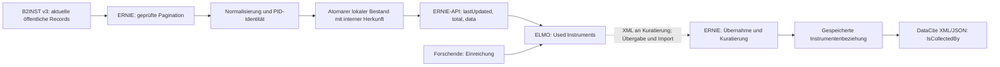

# Implementierungsplan: PIDINST-Implementierung in den GFZ Data Services

Stand: 29. Oktober 2026. Status: **wissenschaftlicher Erstentwurf v0.1 erstellt**. [Manuskriptprojekt und Build-Anleitung](publications/pidinst/README.md), [PDF](publications/pidinst/build/main.pdf) und [offene Autorenangaben](publications/pidinst/evidence/open-points.md) liegen lokal vor. Der englische Text enthält eine deutsche Zusammenfassung, zwei Vektorabbildungen, zwei Tabellen und geprüfte Literatur einschließlich der ELMO-Software-DOI. ORCID und ROR sind auf der Titelseite über Logo-Icons verlinkt. Veröffentlichung und Autorenfreigabe stehen aus; der Publikationsordner ist derzeit durch die zentrale `.gitignore` ausgeschlossen.

Die folgenden Abschnitte bewahren den Planungszusammenhang. Der aktuelle Prüfstatus steht in [evidence/validation.md](publications/pidinst/evidence/validation.md); Abschnitt 8 dokumentiert die Erfüllung der Kriterien für den Erstentwurf. Die fehlende vollständige ELMO-Abnahme und die offenen redaktionellen Angaben sind keine behaupteten Ergebnisse.

## 0. Implementierungsstand für den Artikel

Die vorausgehende B2INST-v3-Modernisierung ist im Commit **`aacaae7e374da97832d40872c4f7fb907d88ab57`** (*Fix B2INST v3 synchronization and instrument PID resolution*, 29. Oktober 2026) implementiert. Dieser Commit ist der Referenzstand für den Artikel. Der Quellcode, die neuen Tests, die [Integrationsdokumentation](b2inst-integration.md) und vorhandene lokale Prüfartefakte wurden für diese Planaktualisierung abgeglichen. Ein weiterer vorgelagerter Implementierungsschritt ist für den Beginn des Manuskripts nicht vorgesehen.

Der [Modernisierungsplan](b2inst-v3-modernization-plan.md) bleibt die historische Planung; maßgeblich für Aussagen über das fertige Verhalten sind der festgeschriebene Code und die Integrationsdokumentation. Die Modernisierung umfasst den v3-Client, PID-Auflösung, vollständige Bestandsprüfung, atomare Ablage, Änderungen bei gleicher Instrumentenanzahl und die Cache-Weitergabe an ELMO/ELMO-MSL.

Die ursprüngliche Versionsfrage ist geklärt: Schon der vorherige Standardhost lieferte v3-Antworten; der alte Dokumentationslink war kein Nachweis einer v2-Anbindung. Der Artikel beschreibt die nun explizit auf v3 abgestimmte Integration und ihre überprüfbaren Eigenschaften. Funktionen, die B2INST v3 allgemein anbietet, die GFZ-Integration aber nicht nutzt, gehören in den Ausblick.

Implementierungsbefund, vorhandene Prüfergebnisse und noch zu sichernde Publikationsbelege werden in Abschnitt 2 getrennt aufgeführt. Ein vollständiger Durchlauf durch eine separat betriebene ELMO-Oberfläche und ein produktiver Rollout sind dort weiterhin eigene Nachweise; sie blockieren die Ausarbeitung eines entsprechend eingegrenzten Erstentwurfs nicht.

## 1. Ziel und bestätigte Entscheidungen

Es entsteht ein englischsprachiger wissenschaftlicher Implementierungsbericht mit deutscher Zusammenfassung. Er beschreibt PIDINST bei GFZ Data Services anhand des Zusammenspiels von B2INST, ELMO und ERNIE. Der Beitrag verbindet den Einreichungsprozess aus Sicht der Forschenden mit der technischen Bereitstellung, Kuratierung und maschinenlesbaren Verknüpfung von Instrumenten und Datensätzen.

**Verbindliche Workflow-Angabe des Auftraggebers:** Forschende reichen ihre Daten über ELMO ein. In der Formulargruppe **Used Instruments** können sie die zur Erzeugung der Daten verwendeten Instrumente auswählen, sofern diese über die ERNIE-API angeboten werden. Diese Auswahl in ELMO bildet einen zentralen Bestandteil des Artikels.

| Entscheidung | Festlegung |
| --- | --- |
| Arbeitstitel | *Implementing PIDINST at GFZ Data Services: Linking Research Instruments and Datasets through ELMO and ERNIE* |
| Beitragstyp | Implementierungsbericht mit nachvollziehbarer Fallstudie und Diskussion der Grenzen |
| Zielgruppe | Forschende, Forschungsdatenmanagement, Repositorienbetreiber und PID-Community |
| Sprache | Englischer Haupttext und Abstract, zusätzliche deutsche Zusammenfassung |
| Umfang | Etwa 8–12 Seiten einschließlich Abbildungen, zuzüglich Literaturverzeichnis |
| Evidenz | Festgeschriebener Implementierungs-Commit, vorhandene Tests und Prüfartefakte, dokumentierter Testhost-Dry-Run und öffentliche Fachquellen; keine vorausgesetzten Betriebskennzahlen |
| Ergebnis der späteren Umsetzung | Vollständiger wissenschaftlicher Erstentwurf, LaTeX-Quellen, Literaturdatenbank, Abbildungen und kompiliertes PDF; fehlende Fakten ausdrücklich markiert |
| Ablage | `docs/publications/pidinst/` im ERNIE-Repository |
| Bearbeitung | Reproduzierbarer lokaler PDF-Build und für Overleaf geeignete Quellenstruktur |
| Publikationsweg | Zunächst Preprint über GEO-LEOe-docs/FID GEO, später gegebenenfalls Zeitschriftenfassung |
| Veröffentlichung | Manuell durch Holger Ehrmann; die Umsetzung endet mit der Übergabe der lokalen Dateien |

Dieser Dokumentplan bereitet das Manuskript auf Basis der vorhandenen Implementierung vor. Während der Artikelrecherche entdeckte Implementierungsunterschiede werden als Befunde dokumentiert und bei Bedarf separat bearbeitet.

### Autoren und Affiliation

Die Autorenreihenfolge folgt der Vorgabe:

1. **Holger Ehrmann**, ORCID: <https://orcid.org/0009-0000-1235-6950>
2. **Tatjana Antipanova**, ORCID: <https://orcid.org/0009-0003-4793-2913>

Beide erhalten dieselbe Affiliation: **GFZ Helmholtz Centre for Geosciences, Potsdam, Germany**, ROR: <https://ror.org/04z8jg394>. Die englische Institutionsbezeichnung und die Zuordnung der ROR-ID werden auch auf der [GFZ-GEOFON-Kontaktseite](https://geofon.gfz.de/contact/) verwendet. Namen, Reihenfolge, ORCIDs und gemeinsame Affiliation stammen aus der Nutzerangabe; ein unabhängiger Abgleich der ORCID-Profilinhalte war bei der Vorprüfung nicht möglich.

Korrespondenzadresse, Autorenbeiträge, Förderung, Danksagung und Manuskriptlizenz bleiben kenntlich gemachte redaktionelle Angaben. Sie werden weder aus Repository-Aktivitäten abgeleitet noch erfunden. Ihre Festlegung ist keine Voraussetzung für das Erstellen des Erstentwurfs.

## 2. Ausgangsbefund und Nachweisgrenzen

Die folgende Befundtabelle beschreibt den Implementierungsstand **`aacaae7e374da97832d40872c4f7fb907d88ab57`**. Sie ersetzt die Vorprüfung vor der Modernisierung. Bei späteren Änderungen wird für den Artikel ausdrücklich entschieden, ob der Referenzstand beibehalten oder mit zugehörigen Prüfbelegen aktualisiert wird.

Für diese Planaktualisierung wurden Quellcode, Testdefinitionen, Integrationsdokumentation sowie die vorhandenen Dateien `.tmp/b2inst-backend-validation.log` und `.tmp/b2inst-live-summary.json` gelesen. Die darin dokumentierten Läufe wurden nicht erneut ausgeführt. Ein vorhandener Test, ein protokollierter Testlauf und eine produktive Nutzung bleiben unterschiedliche Belegarten.

| Gegenstand | Lokaler Beleg | Bedeutung für den Artikel |
| --- | --- | --- |
| V3-Abruf und Vollständigkeit | [B2instClient.php](../app/Services/B2inst/B2instClient.php), [b2inst.php](../config/b2inst.php) | Standardhost `https://b2inst.pid.gwdg.de`; `/api/records` mit `sort=newest` und `allversions=false`. Prüfung von Pagination, Summen, IDs, Suchumfang und erster Seite; ein Neustart bei erkanntem Bestandswechsel innerhalb des Zeitbudgets. Redirects werden abgewiesen. |
| Normalisierung und PID-Identität | [B2instInstrumentNormalizer.php](../app/Services/B2inst/B2instInstrumentNormalizer.php), [B2instPidResolver.php](../app/Services/B2inst/B2instPidResolver.php) | Öffentliche, veröffentlichte, aktuelle, nicht gelöschte Records mit `SchemaVersion="1.0"`; Vergleich von Metadaten- und ePIC-Handle. Abweichende oder fehlende Provider-Angaben führen zur gezielten Auflösungs-/Identitätsprüfung. Unbekannte Typen werden nicht zu Handles umbenannt. |
| Bestandsabgleich und sichere Ablage | [B2instSyncService.php](../app/Services/B2inst/B2instSyncService.php), [B2instSnapshotStore.php](../app/Services/B2inst/B2instSnapshotStore.php) | Gemeinsame Sperre, Änderungsvergleich, Ausschlussdiagnosen und lesende Prüfung gespeicherter Instrumentenverweise. Atomarer Dateiaustausch auf lokalem Dateisystem, vorheriger Bestand bei Änderungen als `.previous`; bestehende Datensatz-PIDs werden nicht umgeschrieben. |
| Betrieb und Wiederholung | [GetPid4instInstruments.php](../app/Console/Commands/GetPid4instInstruments.php), [Integrationsdokumentation](b2inst-integration.md) | `--dry-run` prüft ohne Veröffentlichung; `--refresh-caches` wiederholt die Weitergabe ohne erneutes Harvesting. Datenveröffentlichung und anschließender Refresh-Fehler sind getrennt erkennbar. |
| API für ELMO | [routes/api.php](../routes/api.php), [VocabularyController.php](../app/Http/Controllers/VocabularyController.php) | `GET /api/v1/vocabularies/pid4inst-instruments` ist durch `ernie.api-key` geschützt und dem Editor-Kontext `elmo` zugeordnet. |
| Aktivierung für ELMO | [PidSetting.php](../app/Models/PidSetting.php), [EditorContext.php](../app/Enums/EditorContext.php) | `is_elmo_active` ist unabhängig von `is_active` für ERNIE. Der ELMO-Status wird über `/api/v1/elmo/vocabularies/pid-availability` angeboten. |
| Datenauslieferung und interne Herkunft | [VocabularyController.php](../app/Http/Controllers/VocabularyController.php), [B2instSyncService.php](../app/Services/B2inst/B2instSyncService.php) | Die API liefert auch bei Cachetreffern nur `lastUpdated`, `total` und `data`. `_sync` mit Quellhost, Versionen, IDs, Vergleich und Refresh-Status bleibt intern. `available` bezeichnet weiterhin die editorbezogene Aktivierung und keine Prüfung der Datendatei. |
| Aktualitätsanzeige | [Pid4instStatusService.php](../app/Services/Pid4instStatusService.php), [pid-settings-card.tsx](../resources/js/components/settings/pid-settings-card.tsx) | `comparisonBasis="count"` kennzeichnet den schnellen Anzahlvergleich. Vollständige Aktualisierung ist auch bei gleicher Anzahl möglich; angezeigte Ergebnisse stammen aus dem Job. `lastUpdated` bezeichnet die letzte Inhaltsänderung, `_sync.checkedAt` den letzten erfolgreichen vollständigen Vergleich. |
| Weitergabe an ELMO | [B2instSyncService.php](../app/Services/B2inst/B2instSyncService.php), [ElmoCacheRefreshDispatcherService.php](../app/Services/ElmoCacheRefreshDispatcherService.php), [UpdatePidJob.php](../app/Jobs/UpdatePidJob.php) | Nach Veröffentlichung werden ERNIE-Cache und aktivierte ELMO-/ELMO-MSL-Ziele über einen gemeinsamen Pfad aktualisiert bzw. benachrichtigt. `refreshPending` erlaubt Wiederholung; erfolgreiches Einreihen eines Jobs ist noch keine Bestätigung seiner Ausführung in ELMO. |
| Auswahl in ELMO | Bestätigte Workflow-Angabe und öffentliche Quellenprüfung am Commit `79ecbe94ccb51a7853525ff46ddb1deb53b2293c`; [Prüfnotiz](publications/pidinst/evidence/elmo-source-review.md) | **Used Instruments**, serverseitiger ERNIE-Abruf, Cache, Auswahl von PID/Typ und Speicherung als `IsCollectedBy` sind im Quellcode belegt. Die Einreichungsroutine erzeugt XML und versendet es an die Kuratierung; eine vollständige ELMO-zu-ERNIE-Abnahme bleibt offen. |
| Kuratierungsoberfläche in ERNIE | [used-instruments-field.tsx](../resources/js/components/curation/fields/used-instruments-field.tsx), [use-pid4inst-instruments.ts](../resources/js/hooks/use-pid4inst-instruments.ts) | ERNIE besitzt eine eigene Instrumentenauswahl. Diese Implementierung ist kein Beleg für die konkrete ELMO-Oberfläche. |
| Speicherung | [ResourceInstrument.php](../app/Models/ResourceInstrument.php), [ResourceStorageService.php](../app/Services/ResourceStorageService.php) | Speicherung von Instrumenten-PID, PID-Typ, Name und Position an einer Ressource. |
| Metadatenimport | [RelatedWorkAndInstrumentSectionParser.php](../app/Services/Xml/Sections/RelatedWorkAndInstrumentSectionParser.php), [UploadJsonController.php](../app/Http/Controllers/UploadJsonController.php) | XML- und JSON-Import ordnen aktuell nur `IsCollectedBy` mit Typ `Handle` der Instrumentengruppe zu. Andere Kombinationen verbleiben bei den allgemeinen Beziehungen. |
| DataCite-Export | [DataCiteXmlExporter.php](../app/Services/DataCiteXmlExporter.php), [DataCiteJsonExporter.php](../app/Services/DataCiteJsonExporter.php) | Die Exporter verwenden DataCite 4.7 und geben gespeicherte Instrumente als `relatedIdentifier` mit ihrem PID-Typ und `relationType="IsCollectedBy"` aus. |

### Vorhandene Prüfergebnisse und noch zu sichernde Belege

| Beleg | Vorliegender Stand | Verwendung im Artikel |
| --- | --- | --- |
| Backend-Abschlussprüfung | Das lokale Protokoll `.tmp/b2inst-backend-validation.log` enthält die Kette `npm run check:backend` mit Pint, Pest, JSON-LD-Prüfung und abschließend PHPStan `[OK] No errors`. Die Pest-Ausgabe weist auch 41 übersprungene Tests aus. | Als vorhandenen Laufbeleg archivieren; die tatsächlich ausgeführten relevanten Tests zuordnen und übersprungene Tests nicht als bestanden zählen. |
| Vollständiger Testhost-Dry-Run | `.tmp/b2inst-live-summary.json` und [Integrationsdokumentation](b2inst-integration.md): Abschluss am **29.10.2026 um 06:57:58 MEZ**, `serverCount=815`, `readCount=815`, `itemCount=812`, Dauer **379,66 Sekunden**, `published=false`. | Technische Beobachtung an der Testinstanz. Kein Produktionsbestand, kein Benchmark und kein Nachweis einer Veröffentlichung oder ELMO-Übertragung. |
| Drei ausgeschlossene Testrecords | `223c8-mht03`, `5ym0a-fqh54`, `a8rcw-s5m75`: kein ePIC-Provider-PID und Metadaten-Handle explizit nicht gefunden. | Unterschied zwischen vollständig gelesenen Records und fachlich akzeptierten Instrumenten erklären; keine unbemerkte fehlende Seite. |
| Migrierter GFZ-Record | [B2instFixture.php](../tests/pest/Fixtures/B2instFixture.php) und [Normalizer-Test](../tests/pest/Unit/Services/B2inst/B2instInstrumentNormalizerTest.php) bilden die zuvor öffentlich geprüften Identitätsangaben ab. Beschreibende Fixture-Metadaten sind synthetisch. | Nachvollziehbares Regressionsbeispiel für die PID-Auswahl; Fixture nicht als vollständige unveränderte Registerkopie ausgeben. |
| DataCite-Roundtrip | [Command-Test](../tests/pest/Feature/Commands/GetPid4instInstrumentsCommandTest.php) enthält Synchronisierung, Übernahme des Handles in eine Testressource, XML-Export mit `IsCollectedBy` und erneutes Parsen. | Belegter Testpfad für Identitätserhalt auf ERNIE-Seite; kein ELMO-Browsertest. |
| Frontend-Abschlussprüfung | Aktuelle Vitest-Fälle für Aktualisierung bei gleicher Anzahl und echte Job-Ergebniswerte sind vorhanden. Ein gesondertes finales Frontend-Laufprotokoll wurde bei diesem Abgleich nicht gefunden. | Vor einer Aussage über erfolgreiche vollständige Frontend-Validierung den Laufbeleg ergänzen; dies ist eine offene Evidenzaufgabe, kein festgestellter Testfehler. |
| ELMO-Oberfläche und Produktionsbetrieb | Die fachliche Nutzung ist durch den Auftraggeber bestätigt; ein versionierter vollständiger ELMO-/Stage-Abnahmelauf oder Produktionsrollout ist in den geprüften Artefakten nicht belegt. | Bei Bedarf ergänzen, sonst die Reichweite der Fallstudie ausdrücklich auf die belegten Teile begrenzen. |

Die benötigten Ergebnisse aus den lokalen `.tmp`-Dateien wurden in [evidence/](publications/pidinst/evidence/) übernommen: reduzierter Dry-Run-Bericht und Backend-Protokollauszug einschließlich Herkunft, SHA-256 der Originale, Prüfumgebung und Grenzen der Versionszuordnung. Die Originale enthalten keinen Commit; daraus wurde keine CI-Attestierung abgeleitet. Eine dauerhafte externe Ablage des Manuskriptpakets bleibt vor Veröffentlichung zu ergänzen. Vollständige Anwendungstests wurden allein für die Textarbeit nicht wiederholt.

### Für die Argumentation relevante Grenzen

- **PIDINST, PID4INST und B2INST:** PIDINST als fachliche Initiative und Metadatenmodell erklären; `pid4inst`/`PID4INST` als Bezeichnungen im ERNIE-Code kenntlich machen; B2INST als verwendetes Register benennen. Daraus keine getrennten, unbelegten Standards ableiten.
- **Instrumenteninstanz und Instrumententyp:** Ein identifiziertes konkretes Instrument von einem GCMD-Instrumentenbegriff oder einer Modellbezeichnung unterscheiden.
- **PID-Verwendung und Registrierung:** Der nachgewiesene ERNIE-Code importiert und verknüpft Instrumenten-PIDs. Eine eigene Vergabe neuer Instrumenten-PIDs durch ERNIE oder ELMO ist damit nicht belegt.
- **Angebot und Aktualität:** Aktivierung, lokale Daten, Anzahlvergleich und vollständigen Metadatenvergleich getrennt beschreiben. Kein unbelegtes Aktualisierungsintervall und keinen B2INST-Live-Abruf bei jeder ELMO-Auswahl behaupten. `lastUpdated` und `_sync.checkedAt` haben unterschiedliche Bedeutung.
- **Import und Export:** Der Register-Normalizer unterstützt `Handle`, `DOI` und `URL`; unbekannte Typen werden mit Diagnose ausgeschlossen. Die besondere Instrumentenzuordnung beim DataCite-XML-/JSON-Import bleibt auf `IsCollectedBy` plus `Handle` begrenzt. Eine erhaltene allgemeine Beziehung ist nicht gleichbedeutend mit einer erhaltenen Instrumentengruppierung.
- **PID-Prüfung:** Übereinstimmende Metadaten-/Provider-Handles werden normalisiert, ohne bei jedem Import erneut aufgelöst zu werden. Fehlende oder abweichende Provider-Angaben erfordern zusätzliche Identitätsevidenz. Daher keine allgemeine Behauptung, jeder importierte PID sei bei jedem Lauf live geprüft worden.
- **Konsistenz und Weitergabe:** Der Client prüft Summen, IDs und die erste Seite erneut; gleich große Veränderungen auf Zwischenseiten können unerkannt bleiben. Atomare lokale Ablage erzeugt keine Snapshot-Isolation im entfernten Register. Ein erfolgreicher ELMO-Dispatch bestätigt die Einreihung, nicht die dortige Anzeige.
- **Betrieb und Wirkung:** Quellcode und kontrollierte Beispiele belegen weder den produktiven Rollout noch verbesserte Datenqualität, Zeitersparnis, Nutzungszahlen oder vollständige FAIR-Konformität. Solche Wirkungen als Motivation bzw. mögliche Vorteile diskutieren.
- **Version und Umfang der B2INST-Nutzung:** Der Importer verweist auf die v3-Records-Dokumentation und nutzt die lesende API für aktuelle öffentliche Instrumente mit PIDINST-Schema `1.0`. Instrumentenregistrierung, Draft-Bearbeitung, private Records und Datei-Uploads sind keine implementierten ERNIE-Funktionen dieses Vorhabens. Intern aufbewahrte Community-/Versionsangaben sind nicht automatisch zusätzliche ELMO-Suchfunktionen.

## 3. Wissenschaftliche Leitfrage und Aufbau

Leitfrage: **Wie lässt sich die Identifikation verwendeter Forschungsinstrumente so in die Einreichung und Kuratierung bei GFZ Data Services integrieren, dass nachvollziehbare, maschinenlesbare Beziehungen zwischen Datensätzen und Instrumenten entstehen?**

Der wissenschaftliche Beitrag liegt in der dokumentierten Integration eines bestehenden PID-Konzepts in einen konkreten Repositoriumsworkflow: Forschende treffen die fachliche Auswahl in ELMO; ERNIE stellt Instrumentendaten bereit, unterstützt die Kuratierung und bildet die Beziehungen im DataCite-Export ab. Die v3-Implementierung liefert konkrete Untersuchungsgegenstände: Identitätserhalt bei migrierten Registereinträgen, nachvollziehbare Auswahl gültiger Records und Aktualisierung ohne Verlust vorhandener Datensatzverweise. Neuheit und Übertragbarkeit werden gegenüber vorhandenen PIDINST-Implementierungen begründet, ohne einen neuen Standard zu beanspruchen.

| Geplanter Abschnitt | Inhalt | Richtumfang |
| --- | --- | --- |
| Title, Abstract, Keywords, Zusammenfassung | Problem, Ansatz, belegtes Ergebnis und Grenzen; deutscher Text mit gleichem Aussageumfang | 1 Seite |
| 1. Introduction | Instrumentenidentität, Datenherkunft, GFZ Data Services und Ziel des Beitrags | 1 Seite |
| 2. Background and Related Work | PIDINST, B2INST, DataCite, Instrumenteninstanz versus Typ; Vergleich mit bestehenden Ansätzen | 1–1,5 Seiten |
| 3. Workflow and Requirements | Forschende in ELMO, **Used Instruments**, ERNIE-API, Verantwortlichkeiten und Verfügbarkeit | 1–1,5 Seiten |
| 4. Implementation | V3-Abruf, PID-Auflösung, atomarer Bestand und interne Herkunft, ELMO-Projektion/Cache-Weitergabe sowie DataCite-Export | 2–2,5 Seiten |
| 5. Worked Example and Technical Validation | Kontrollierte Fallstudie, migrierter GFZ-PID-Fall, DataCite-Roundtrip und eingeordneter Testhost-Dry-Run | 1–1,5 Seiten |
| 6. Discussion and Limitations | Übertragbarkeit, Resolverabhängigkeit, fehlende Server-Snapshot-Isolation, ELMO-Nachweisgrenze, Importgrenzen und fehlende Betriebsdaten | 1–1,5 Seiten |
| 7. Conclusions | Beantwortung der Leitfrage innerhalb der nachgewiesenen Reichweite | 0,5 Seite |
| Declarations and References | Software-/Datenverfügbarkeit, Beiträge, Förderung, Danksagung und Literatur | Nach Bedarf |

Die Seitenzahlen sind Richtwerte. Quellenbelege und verständliche Abbildungen haben Vorrang vor künstlicher Verdichtung.

### Architekturabbildung und Fallstudie

Die folgende Skizze zeigt den geplanten Ablauf. Die fertige Architekturabbildung berücksichtigt inzwischen die geprüfte XML-Einreichung an die Kuratierung. Ihre gestrichelte Kante kennzeichnet die noch nicht gemeinsam abgenommene Übergabe und den Import in ERNIE.



Geplant sind zwei bis drei Abbildungen und zwei kompakte Tabellen:

1. Architektur und Rollen entlang des obigen Ablaufs, einschließlich der Grenze zwischen ELMO und ERNIE.
2. Datenmodell bzw. PID-Beziehung: **Datensatz → IsCollectedBy → Instrument**. Die semantische Gegenrichtung `Collects` nur erläutern; keine tatsächlich gespeicherte Rückverknüpfung im Register behaupten.
3. Falls anhand zugänglicher ELMO-Quellen möglich: echte Aufnahme der Formulargruppe **Used Instruments** mit kontrollierten Beispieldaten. Andernfalls eine als schematisch bezeichnete Prozessdarstellung; keinen nachgebauten Screenshot als tatsächliche Oberfläche ausgeben.
4. Mapping-Tabelle vom Registerfeld über API und Speicherung bis zum DataCite-Feld.
5. Tabelle der nachgewiesenen Prüfungen und ihrer Reichweite.

Die Fallstudie kombiniert drei klar getrennte Belegarten:

1. **Kontrollierter Ablauf:** Ein synthetischer v3-Record aus `B2instFixture::record()` wird von Normalisierung und öffentlicher API-Projektion bis zur Instrumentenbeziehung und zum DataCite-Export verfolgt. Der vorhandene XML-Roundtrip prüft den erneuten Import des Handles; die JSON-Darstellung wird anhand der vorhandenen Exporttests erläutert.
2. **Öffentlich belegte Migrationsidentität:** `B2instFixture::migrated()` bildet Record `7z780-7kj63` ab. Der Metadaten-Handle `21.11157/7z780-7kj63` war bei der Vorprüfung nicht registriert; der ePIC-Handle `21.11157/d96a9d31-fd99-4a0c-9b98-514a04b18423` führte zum selben Instrument. Die Regression zeigt die Auswahl des passenden registrierten Provider-PIDs. Die historischen Resolverbeobachtungen erhalten ein Abrufdatum; synthetische Beschreibungen im Fixture werden nicht als öffentliche Originaldaten ausgegeben.
3. **Dokumentierter vollständiger Testabruf:** 815 gelesene Records, 812 akzeptierte Instrumente und drei begründete Ausschlüsse im Dry-Run aus Abschnitt 2. Die Laufzeit wird nur mit ihrem konkreten Aufbau berichtet und nicht als allgemeine Leistungszusage ausgewertet. Da `published=false` und ELMO-Dispatch deaktiviert waren, ist dies kein Nachweis der anschließenden Bestandsveröffentlichung oder ELMO-Anzeige.

Ein zweites synthetisches Instrument kann die Mehrfachauswahl veranschaulichen. Beispiele werden nicht registriert und nicht als produktive GFZ-Datensätze dargestellt. Der Erhalt bereits gespeicherter PIDs sowie eine Aktualisierung bei unveränderter Instrumentenanzahl liefern zusätzliche kontrollierte Gegenprüfungen.

Der ELMO-Teil wird zunächst auf Grundlage der bestätigten Workflow-Beschreibung erläutert. Erst nach Prüfung einer passenden ELMO-Version dürfen Aussagen über den tatsächlichen Export, Übertragungsweg oder einen erfolgreich ausgeführten vollständigen ELMO–ERNIE-Durchlauf hinzukommen. Kann dieser Teil nicht unabhängig geprüft werden, bleibt diese Grenze im Erstentwurf sichtbar; die belegte ERNIE-Fallstudie kann trotzdem ausgearbeitet werden.

## 4. Quellenarbeit und Nachvollziehbarkeit

Vor dem Schreiben wird eine Evidenztabelle angelegt. Jede wesentliche Aussage erhält einen Beleg, einen Versions- oder Datumsstand und einen Status: **Quellcodebefund**, **durchgeführte Prüfung**, **öffentliche Fachquelle**, **Autorenangabe** oder **offen**. Für Softwarebelege werden Commit und Pfad gespeichert, für ausgeführte Prüfungen zusätzlich Befehl, Umgebung und Ergebnis.

Öffentliche Quellen werden bevorzugt direkt bei den verantwortlichen Einrichtungen oder Herausgebern recherchiert. Ein zunächst sinnvoller Ausgangsbestand ist:

| Quelle | Verwendung und Bearbeitungsaufgabe |
| --- | --- |
| [Stocker et al. (2020), Persistent Identification of Instruments](https://nora.nerc.ac.uk/id/eprint/527952/1/1135-7520-2-PB.pdf), DOI `10.5334/dsj-2020-018` | Grundlagen und vorhandene Implementierungen. Vollständigen bibliografischen Datensatz mit dem Originalartikel abgleichen. |
| [RDA: Metadata Schema for the Persistent Identification of Instruments](https://www.rd-alliance.org/groups/persistent-identification-instruments-wg/outputs/metadata-schema-for-the-persistent-identification-of-instruments/), DOI `10.15497/RDA00070` | Normative Grundlage und konkret verwendete Schemaversion ermitteln. |
| [PIDINST White Paper: Linking instrument PIDs to datasets](https://docs.pidinst.org/en/latest/white-paper/linking-datasets.html) | Fachliche Empfehlung für die Verknüpfung. Die bewegliche `latest`-Dokumentation mit Abrufdatum und nach Möglichkeit festem Versionsstand belegen. |
| [EUDAT B2INST-v3-Übersicht](https://docs.eudat.eu/b2inst/v3-rest/overview/), [Records-API](https://docs.eudat.eu/b2inst/v3-rest/records/) und [v2/v3-Strukturvergleich](https://docs.eudat.eu/b2inst/v3-rest/json_diff_v2_v3/) | Maßgebliche Schnittstellenbeschreibung, Provider-PIDs und Versionierung; ältere Strukturen nur zur Erklärung migrierter Records. |
| [DataCite 4.7: relationType](https://datacite-metadata-schema.readthedocs.io/en/4.7/appendices/appendix-1/relationType/) | Bedeutung und Richtung von `IsCollectedBy`/`Collects`; übrige relevante Felder mit derselben Schemaversion abgleichen. |
| [GFZ: FID GEO](https://www.gfz.de/sektion/daten-und-informationsmanagement/projekte/fid-geo-fachinformationsdienst-fuer-die-geowissenschaften-der-festen-erde) | Institutioneller Kontext von Text- und Forschungsdatenpublikation. |
| [FID GEO: Textpublikationen](https://www.fidgeo.de/text-publikationen/text-publikationen) | PDF als Publikationsformat, DOI und manueller Veröffentlichungsworkflow. Eine Begutachtung des geplanten Preprints ist nicht vereinbart. |
| [B2INST-Integrationsdokumentation](b2inst-integration.md), ERNIE-Code und Tests im Referenz-Commit | Implementierter v3-Vertrag, PID-Entscheidungen, interne Herkunft, Testhost-Beobachtungen und Betriebsgrenzen. Lokale Laufbelege zusätzlich dauerhaft in `evidence/` sichern. |
| Noch zu ermittelnde öffentliche ELMO-Quellen | ELMO **Used Instruments**, API-Verwendung und Übergabe an ERNIE mit eigenem Versionsstand belegen. |

Diese Quellenliste ist ein Startpunkt, noch kein vollständiges Literaturreview. Bei der Ausarbeitung werden insbesondere öffentliche GFZ-Data-Services-/ELMO-Beschreibungen, vergleichbare Integrationen und die Originalpublikation der FAIR-Prinzipien geprüft und nur bei inhaltlicher Verwendung aufgenommen.

Bibliografische Metadaten werden nicht ungeprüft aus Quellcodekommentaren oder Überblicksseiten kopiert. Die PIDINST-Startseite verweist bei Stocker et al. derzeit beispielsweise auf `10.5334/dsj-2020-043`; dieser DOI führt zu [The CARE Principles for Indigenous Data Governance](https://datascience.codata.org/articles/10.5334/dsj-2020-043). Für den PIDINST-Artikel ist der oben anhand des Original-PDFs identifizierte DOI `10.5334/dsj-2020-018` zu verwenden.

## 5. LaTeX-Projekt und PDF-Build

Vorgesehene Struktur für die spätere Umsetzung:

```text
docs/publications/pidinst/
  README.md                         # Build, Bearbeitung und Export nach Overleaf
  main.tex                          # Einstiegspunkt, Abschnitte und Literatur
  metadata.tex                      # Titel, Autoren, ORCIDs, Affiliation, ROR, Version
  preamble.tex                      # Layout und Pakete
  references.bib                    # Verifizierte bibliografische Einträge
  latexmkrc                         # LuaLaTeX-/Biber-Konfiguration
  .gitignore                        # Generierte Build-Ausgaben
  sections/
    abstract.tex
    zusammenfassung.tex
    introduction.tex
    background.tex
    workflow.tex
    implementation.tex
    worked-example.tex
    discussion.tex
    conclusions.tex
    declarations.tex
  figures/
    architecture.tex                # Vektorgrafiken, z. B. mit TikZ
    pid-relations.tex
  tables/
    metadata-mapping.tex
    validation.tex
  examples/
    README.md                       # Herkunft und synthetischer Charakter der Beispiele
    instrument-record.json
    migrated-instrument-record.json # Gekennzeichnete Regression mit öffentlichen Identitätsangaben
    ernie-instrument-response.json
    datacite-example.xml
    datacite-example.json
  evidence/
    claims.md                       # Aussagen und Belege
    sources.json                    # URLs, Versionen, Commits, Abrufdaten
    validation.md                   # Ausgeführte Prüfungen und Grenzen
    b2inst-dry-run.json              # Relevante Ergebnisfelder des dokumentierten Testhost-Laufs
    open-points.md                  # Fehlende fachliche/redaktionelle Angaben
  tooling/
    build.mjs                       # Plattformübergreifender Docker-Build-Aufruf
    toolchain.json                  # Gepinntes Image samt Digest und Werkzeugständen
  build/                            # Ignorierte PDF-, Log- und Hilfsdateien
```

### Technische Entscheidungen

- **Dokument:** zunächst Standardklasse `article`, A4, 11 pt, einspaltig. Das ist eine Projektentscheidung, keine behauptete FID-GEO-Vorlage. Ein späteres Journal-Layout kann getrennt ergänzt werden.
- **Satz:** LuaLaTeX mit UTF-8 und in der festgelegten TeX-Distribution enthaltenen Schriften; Sprachunterstützung für Englisch und Deutsch. Keine Abhängigkeit von lokal installierten Windows-Schriften.
- **Literatur:** `biblatex` mit Biber, zunächst Autor-Jahr-Stil; DOI-/URL-Verweise anklickbar, Softwareversionen und Abrufdaten nachvollziehbar.
- **Automatisierung:** `latexmk` steuert die nötigen Satz- und Literaturdurchläufe. Ein gesonderter TeX-Live-Container wird bei der Umsetzung auf einen geprüften Image-Digest festgeschrieben. Der Build ist unabhängig von der ERNIE-Anwendung und startet keine Datenbank.
- **Aufruf:** vom Repository-Wurzelverzeichnis aus `node docs/publications/pidinst/tooling/build.mjs`; der Wrapper verwendet dieselben Quellen und dieselbe Konfiguration unter Windows/PowerShell und Linux. Die Node-Version stammt aus der dann aktuellen `.node-version`, nicht aus einem duplizierten Versionswert im Manuskriptprojekt.
- **Ergebnis:** `docs/publications/pidinst/build/main.pdf` sowie lokal prüfbare Logs. Das PDF erhält Titel, Autorennamen, Sprache und eine explizite Manuskriptversion. Preprint-/Entwurfsstatus ist sichtbar; eine noch nicht vergebene Artikel-DOI wird nicht vorgetäuscht.
- **Reproduzierbarkeit:** Gepinnte Toolchain, explizites Manuskriptdatum und lokal vorhandene Literatur/Abbildungen erlauben einen vollständigen Neubau. Keine Literatur- oder Registerabfragen während des Satzes. Eine bitweise identische PDF-Datei wird nur behauptet, wenn sie gesondert nachgewiesen wurde.
- **Overleaf:** `main.tex` bleibt der Einstiegspunkt; alle referenzierten Dateien liegen innerhalb des Publikationsordners. Compiler und passende TeX-Live-Version werden in `README.md` dokumentiert. Ein Quellenarchiv enthält die nötigen `.tex`-, `.bib`- und Grafikdateien; Hilfsdateien und Docker-Werkzeuge werden dafür nicht benötigt. Die tatsächliche Overleaf-Kompilation wird nur als geprüft bezeichnet, wenn sie stattgefunden hat.
- **Abbildungen:** Selbst erstellte Vektorgrafiken mit versionierten Quellen. Kein generatives Bildmaterial für Architektur oder scheinbare UI-Belege.

Die Wahl von `latexmk` stützt sich auf dessen dokumentierte Automatisierung von LaTeX-Durchläufen: [CTAN-Paketbeschreibung](https://ctan.org/pkg/latexmk/?lang=en). Versionsnummer und Image-Digest werden im ersten Build-Schritt ermittelt und geprüft, nicht im Plan geraten. PDF/A wird nur als erfüllt angegeben, wenn ein entsprechendes Profil erforderlich ist und tatsächlich validiert wurde; die geprüften FID-GEO-Hinweise verlangen allgemein PDF.

## 6. Umsetzungsschritte und Ergebnisse

### Schritt 1: Quellenstand und Argumentation festlegen

Ausgangspunkt ist die implementierte v3-Anbindung im Referenz-Commit aus Abschnitt 0. Die verbleibende Arbeit betrifft Quellen, dauerhafte Prüfbelege und wissenschaftliche Darstellung.

1. Commit **`aacaae7e374da97832d40872c4f7fb907d88ab57`**, relevante Code-/Testpfade und Integrationsdokumentation in `evidence/sources.json` erfassen. Die lokalen Backend-/Dry-Run-Artefakte mit Herkunft, Prüfumgebung und nachvollziehbarer Versionszuordnung archivieren; den noch fehlenden Frontend-Laufbeleg ergänzen oder als offene Evidenz markieren.
2. Öffentliche ELMO-Quellen ermitteln und **Used Instruments**, API-Verwendung, Serialisierung und Übergabe an ERNIE gezielt prüfen. Zugängliche Quellen mit Version/Commit belegen; verbleibende Lücken in `open-points.md` und der Evidenztabelle vermerken.
3. PIDINST-Schema, B2INST-Schnittstelle und DataCite 4.7 fachlich abgleichen; Literatur mit verifizierten Titeln, Autoren, Jahren und DOIs erfassen.
4. Die Leitfrage in prüfbare Teilfragen zerlegen: Wie wird die passende Instrumenten-PID bei Migrationen bestimmt? Welche Records werden angeboten oder begründet ausgeschlossen? Wie bleiben Datensatzbeziehungen bei Updates erhalten? Welche Aussagen erlauben Backend-Tests, Dry-Run und ELMO-Vertrag jeweils?

**Ergebnis:** belastbare Gliederung, Quelleninventar und Evidenztabelle. Nicht belegte Betriebsbehauptungen sind aus der Argumentation entfernt oder explizit als offen markiert.

### Schritt 2: Kompilierbares Manuskriptprojekt erstellen

1. Die Struktur aus Abschnitt 5 mit den bestätigten Autorenangaben anlegen.
2. LuaLaTeX, Biber, `latexmk`, Schriften und Toolchain-Pinning konfigurieren.
3. Minimalen englischen und deutschen Text, Literaturzitat, ORCID-/ROR-Link und eine Vektorabbildung kompilieren.
4. Build-Aufruf, Ausgaben und Overleaf-Einstellungen dokumentieren; generierte Hilfsdateien ignorieren.

**Ergebnis:** erfolgreich gebautes Grunddokument. Zu diesem Zeitpunkt ist noch kein vollständiger wissenschaftlicher Erstentwurf erreicht.

### Schritt 3: Kontrollierte Fallstudie und technische Belege ausarbeiten

1. Die drei Belegarten aus Abschnitt 3 ausarbeiten: synthetischer Ablauf, öffentlicher GFZ-Migrationsfall als Regression und dokumentierter vollständiger Testhost-Dry-Run. Feldzuordnung und Identität in den jeweiligen Beispielen konsistent halten.
2. Öffentliche API-Projektion und interne `_sync`-Herkunft unterscheiden. Darstellen, dass der DataCite-Instrumentenverweis PID, PID-Typ und Beziehung transportiert, aber nicht den gesamten Registerdatensatz; Community-/Versionsinformationen nicht als automatisch verfügbare ELMO-Funktion ausgeben.
3. Vorhandene Laufbelege den relevanten Tests zuordnen. Nur konkrete Nachweislücken oder geänderte Beispiele fokussiert neu prüfen und Datum, Commit und Umgebung protokollieren; keinen vollständigen Anwendungstestlauf allein wegen Textarbeit wiederholen.
4. Unveränderte gespeicherte PIDs, gleiche Anzahl bei geänderten Metadaten, fehlgeschlagene Auflösung, begründete Ausschlüsse und ausstehende Cache-Weitergabe als Gegenprüfungen einbeziehen. XML-/JSON-Importgrenzen erläutern und keinen vollständigen ELMO-Ende-zu-Ende-Nachweis aus ERNIE-Teilpfaden ableiten.
5. Architektur- und Beziehungsabbildungen sowie Mapping- und Validierungstabellen fertigstellen.

**Ergebnis:** reproduzierbare ERNIE-Fallstudie mit abgegrenzter Aussagekraft und belegter bzw. ausdrücklich eingegrenzter ELMO-Darstellung.

### Schritt 4: Wissenschaftlichen Erstentwurf schreiben

1. Workflow, Implementierung, Beispiel und Grenzen zuerst aus der Evidenztabelle schreiben.
2. Motivation und verwandte Arbeiten ergänzen; die besondere Integrationsleistung für GFZ Data Services herausarbeiten.
3. Schlussfolgerung ausschließlich aus nachgewiesenen Befunden ableiten, danach englischen Abstract und deutsche Zusammenfassung schreiben.
4. Literatur, Abbildungen und Tabellen vollständig im Text einbinden; fachliche Aussagen mit passenden Primärquellen stützen.
5. Fehlende Angaben durch einheitliche sichtbare Marker kennzeichnen und in `open-points.md` sammeln. Gliederungsplatzhalter werden durch ausformulierte Abschnitte ersetzt; verbleibende Marker betreffen konkrete Fakten oder Autorenangaben.

**Ergebnis:** inhaltlich vollständiger Erstentwurf im vereinbarten Umfang, mit transparenten offenen Punkten und ohne erfundene Ergebnisse.

### Schritt 5: Prüfen und zur manuellen Weiterbearbeitung übergeben

1. Manuskript aus einem leeren `build/`-Verzeichnis neu bauen und Literatur-/Querverweise sowie PDF-Metadaten prüfen.
2. PDF visuell prüfen: Textfluss, Tabellenbreite, Grafikbeschriftungen, Seitenumbrüche, deutsche Sonderzeichen und Links.
3. Autorenreihenfolge, ORCIDs und gemeinsame ROR-Affiliation mit der Nutzerangabe abgleichen.
4. Aussagen zu ELMO, produktivem Einsatz, Registeraktualität und Teststatus gegen die Evidenztabelle prüfen.
5. PDF, vollständige Quellen, Build-Anleitung und Liste offener Autorenangaben bereitstellen. Eine kurze Anleitung nennt die für die manuelle Preprint-Einreichung benötigten Metadaten und den noch auszuwählenden Lizenzwert.

**Ergebnis:** lokal übergebenes Manuskriptpaket für die Autorenprüfung und anschließende manuelle Veröffentlichung durch Holger Ehrmann. Kontoregistrierung, Upload, DOI-Registrierung und Kontaktaufnahme mit FID GEO sind keine automatisierten Arbeitsschritte.

## 7. Prüfstrategie

### Dokument und Manuskript

- Vollständiger Neubau erzeugt ein lesbares PDF und löst alle Literatur- und Querverweise auf.
- Keine fehlenden Dateien, undefinierten Zitate oder Referenzen; Layoutwarnungen werden geprüft und sichtbare Überläufe behoben.
- Der Text ist durchsuchbar, ORCID-/ROR-/DOI-Links sind korrekt, Abbildungen bei normalem Zoom lesbar.
- Englischer Abstract und deutsche Zusammenfassung enthalten dieselben Ergebnisse und Einschränkungen.
- Die Fallstudie ist mit ihren mitgelieferten Beispielen und den dokumentierten Softwareständen nachvollziehbar.
- Der Text unterscheidet vorhandene Testdefinitionen, ausgeführte Tests, Autorenangaben und offene Fakten.

### Anwendungstests als wissenschaftliche Evidenz

Für den Referenzstand existieren folgende Prüfpunkte; zugehörige erfolgreiche Läufe werden anhand der vorhandenen Protokolle bzw. gezielter Ergänzungen dokumentiert:

| Zu prüfender Aspekt | Vorhandener Testpfad |
| --- | --- |
| V3-Vertrag, Pagination, Aliasgruppe, Bestandswechsel, Zeitlimits und Retry | `tests/pest/Unit/Services/B2inst/B2instClientTest.php` |
| Normalisierung, migrierte GFZ-PID, Resolverfehler und unbekannte Typen | `tests/pest/Unit/Services/B2inst/B2instInstrumentNormalizerTest.php` |
| Atomare Veröffentlichung, Dry-Run, Änderungsvergleich, Sperren und Cache-Wiederholung | `tests/pest/Feature/Commands/GetPid4instInstrumentsCommandTest.php` |
| Synchronisierter Handle → DataCite-XML → erneuter Instrumentenimport | Roundtrip-Fall in `tests/pest/Feature/Commands/GetPid4instInstrumentsCommandTest.php` |
| Vokabularantworten und PID-Verfügbarkeit | `tests/pest/Feature/Http/Controllers/VocabularyControllerTest.php` |
| Unabhängige Freischaltung für ERNIE, ELMO und ELMO-MSL sowie Ausblenden von `_sync` | `tests/pest/Feature/Api/EditorVocabularyIsolationTest.php` |
| Anzahlvergleich, Hintergrundjob und Ergebniswerte | `tests/pest/Unit/Services/Pid4instStatusServiceTest.php`, `tests/pest/Feature/Settings/PidSettingsControllerTest.php`, `tests/pest/Unit/Jobs/UpdatePidJobTest.php` und Command-Test |
| Cache-Weitergabe und Fehler beim Einreihen | `tests/pest/Feature/ElmoCacheRefresh/ElmoCacheRefreshTest.php`, `tests/pest/Feature/ElmoCacheRefresh/EditorSettingsRefreshTest.php` |
| Aktualisierung bei gleicher Anzahl und tatsächliches Job-Ergebnis in der Oberfläche | `tests/vitest/components/settings/pid-settings-card-flow.test.tsx` |
| Speicherung, Aktualisierung und unvollständige Instrumente | Instrumentenfälle in `tests/pest/Feature/Services/ResourceStorageServiceTest.php` |
| Instrumente im DataCite-Export | Instrumentenfälle in `tests/pest/Feature/Services/DataCiteXmlExporterTest.php` und `tests/pest/Feature/Services/DataCiteJsonExporterTest.php` |
| Übernahme aus DataCite-JSON | Instrumentenfall in `tests/pest/Feature/JsonUpload/UploadJsonControllerTest.php` |
| ERNIE-Hook und ERNIE-Auswahlfeld | `tests/vitest/hooks/use-pid4inst-instruments.test.ts` und `tests/vitest/components/curation/fields/__tests__/used-instruments-field.test.tsx` |

Der vorhandene XML-Roundtrip prüft den synchronisierten Handle nach Export und erneutem Parsen. Eine vollständige Interaktion mit ELMO ist darin nicht enthalten. Eigenständige ELMO-Tests bzw. ein versionierter Abnahmelauf werden als zusätzlicher Beleg gesucht; bestehende ERNIE-Frontend-Tests bleiben ausdrücklich ERNIE-Tests. Das lokale Backend-Protokoll und der Testhost-Dry-Run werden nach ihren unterschiedlichen Reichweiten ausgewertet, nicht zu einem einzigen Ende-zu-Ende-Ergebnis zusammengefasst.

PHP-Prüfungen laufen ausschließlich über die Repository-Wrapper, beispielsweise `npm run test:php -- tests/pest/Feature/Commands/GetPid4instInstrumentsCommandTest.php`. Für den betroffenen Entwicklungszyklus steht `npm run test:php:tia` bereit. Jede lokale PHP-Validierung verwendet die vorgeschriebenen **2 GB**; MySQL-gestützte Prüfungen verwenden ausschließlich **MySQL 9.7 aus `docker-compose.dev.yml`**. Die MySQL-8.4-Dump-Werkzeuge sind kein Datenbankserver-Ersatz.

Frontend-Prüfungen laufen hostseitig über `npm run test:run -- <testpfad>` mit der exakten Node-Version aus `.node-version`. Meldet `npm ls` ungültige oder zusätzliche Pakete, wird vor Schlussfolgerungen aus den Testergebnissen `npm ci` ausgeführt. Parallelität bleibt bei den Repository-Defaults, sofern kein gemessener Grund für eine Änderung besteht.

Für die jetzige reine Planänderung und spätere reine LaTeX-/Dokumentänderungen ist kein vollständiger Backend- oder Frontend-Lauf erforderlich. Falls separat beauftragte PHP- oder Frontend-Codeänderungen hinzukommen, gelten abschließend `npm run check:backend` bzw. `npm run check:frontend`. Nach einem fehlgeschlagenen vollständigen Lauf zuerst den Fehler fokussiert reproduzieren und beheben; vollständige Line-Coverage bleibt CI-Aufgabe.

## 8. Erfüllte Abnahmekriterien für den Erstentwurf

- [x] Implementierte B2INST-v3-Anbindung im Commit `aacaae7e374da97832d40872c4f7fb907d88ab57` als Artikelgrundlage festgeschrieben; Code, Tests, Integrationsdokumentation und vorhandene Laufartefakte abgeglichen.
- [x] Benötigte Backend-/Dry-Run-Belege mit Herkunft, Original-Hashes und Grenzen der Versionszuordnung im lokalen Manuskriptpaket archiviert; fehlender Frontend-Laufbeleg ausdrücklich benannt. Dauerhafte externe Ablage bleibt ein Veröffentlichungsschritt.
- [x] Vollständiger englischer Erstentwurf mit deutscher Zusammenfassung: zehn Seiten einschließlich Erklärungen, zuzüglich einer Literaturseite.
- [x] ELMO als Einreichungsoberfläche und **Used Instruments** mit der Abhängigkeit vom Instrumentenangebot der ERNIE-API nachvollziehbar dargestellt.
- [x] Rollen von Forschenden, Register und Kuratierung sowie die technische Grenze zwischen ELMO und ERNIE korrekt beschrieben.
- [x] Autoren Holger Ehrmann und Tatjana Antipanova in dieser Reihenfolge, mit verlinkten ORCID-Icons und gemeinsamer Affiliation mit ROR-Icon.
- [x] PIDINST-Grundlagen, relevante Vorarbeiten und DataCite-Mapping anhand geprüfter Quellen erläutert; ELMO-Software-DOI `10.5880/gfz.lis.2026.001` ergänzt.
- [x] Kontrollierte Fallstudie, zwei Vektorabbildungen und zwei kompakte Tabellen vorhanden und im Text ausgewertet.
- [x] Synthetische Beispiele, öffentliche GFZ-Identitätsangaben und Testhost-Beobachtungen klar getrennt; weder die 812 akzeptierten Instrumente noch die Einzel-Laufzeit als Produktionskennzahl ausgegeben.
- [x] Softwarestände, Quellen und tatsächlich ausgeführte Prüfungen nachvollziehbar dokumentiert.
- [x] Importbeschränkungen, fehlende Betriebsdaten und nicht unabhängig geprüfte ELMO-Details offen benannt.
- [x] LaTeX-Quellen, Literatur und Abbildungen unter `docs/publications/pidinst/`; PDF-Build mit gepinnter Toolchain erfolgreich.
- [x] Vollständiger Neubau ohne undefinierte Zitate, Referenzen oder Layoutwarnungen; PDF visuell geprüft.
- [x] Overleaf-geeignete Quellenstruktur, Quellenarchiv und passende Einstellungen dokumentiert; tatsächlicher Overleaf-Build nicht behauptet.
- [x] Offene Autorenangaben und Lizenzentscheidung gesammelt, ohne den Erstentwurf zu blockieren.
- [x] Lokales PDF und Quellenpaket zur Autorenprüfung und anschließenden manuellen Preprint-Veröffentlichung bereitgestellt; keine Veröffentlichung durch den Agenten.
